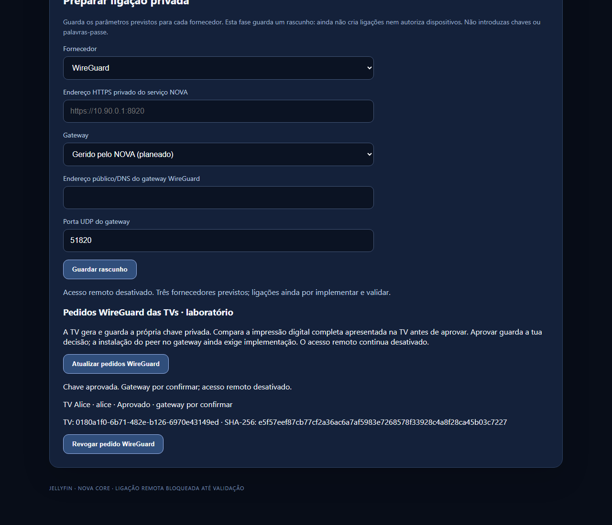
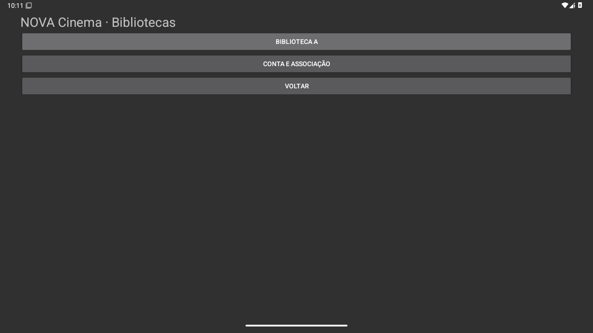
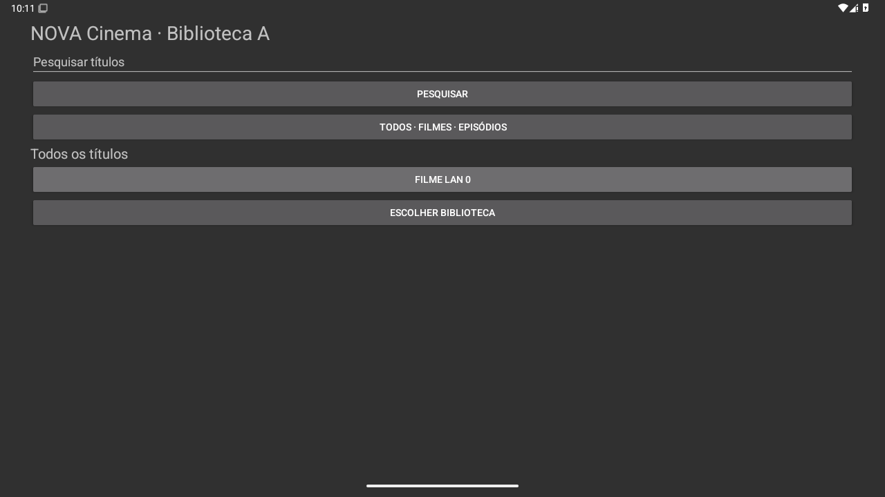
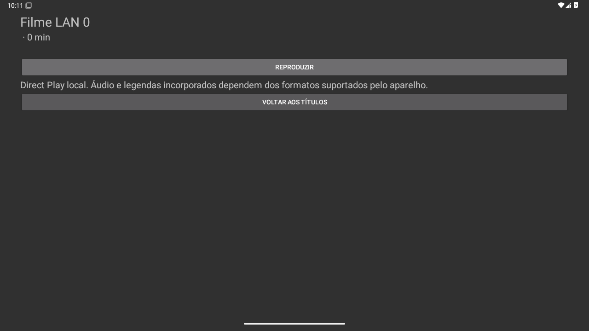
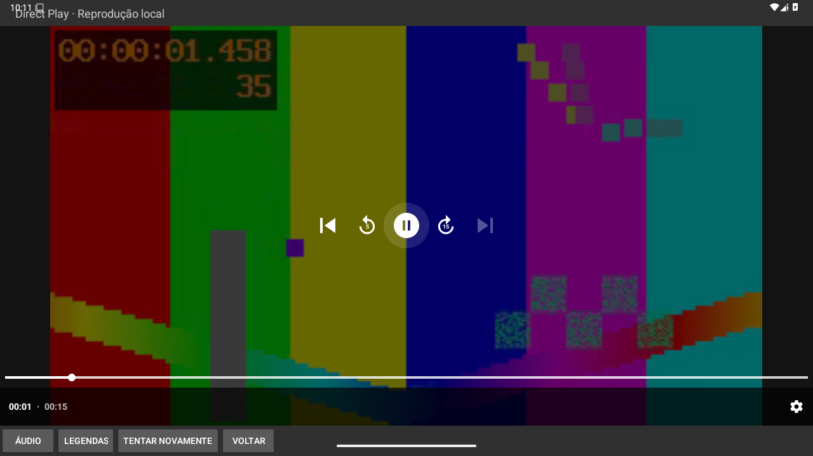
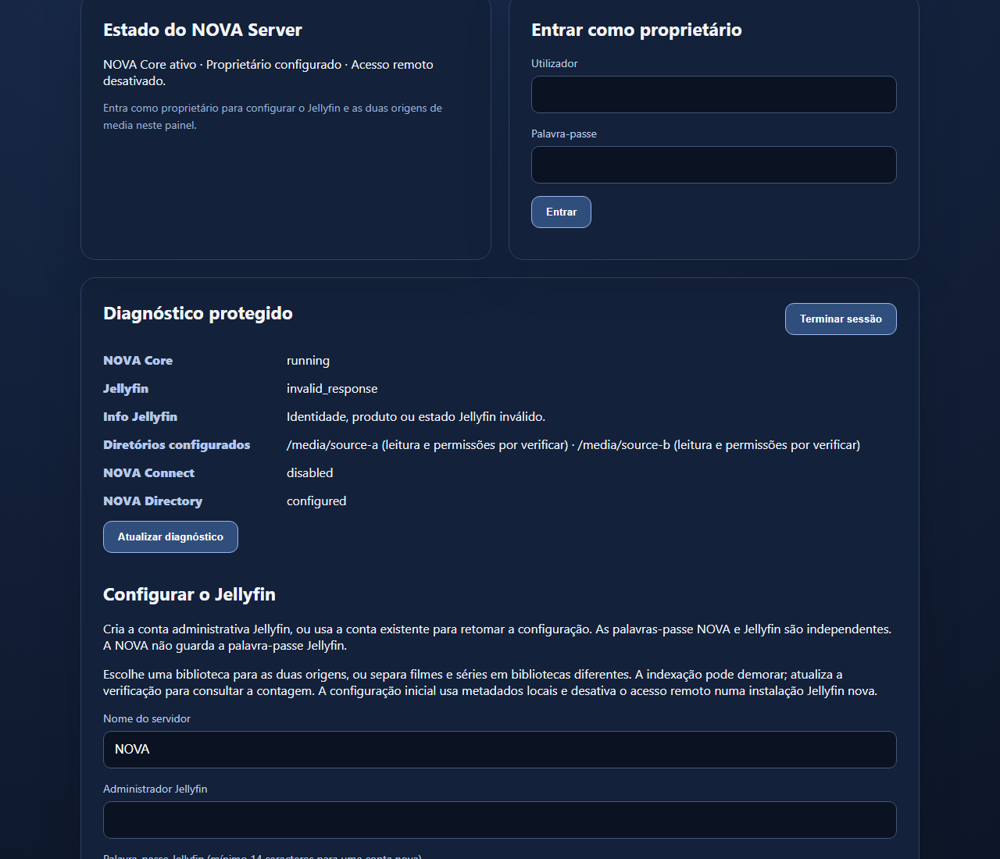

# Capturas reais das apps NOVA

**Incremento de 22 outubro:** [oito capturas do percurso WireGuard](screenshots/wireguard-88efc1a/index.html), recolhidas em emuladores API 26/35 com 37 verificações aprovadas em cada. Vídeo sintético pelo túnel; orientação vertical de emulador, interface provisória. As capturas abaixo preservam o ensaio LAN anterior.

Capturas originais dos ensaios CI: Control no navegador Windows e app Android em emulador horizontal API 35. API 26 também foi executada; imagens adicionais e galeria estão na pasta local `NOVA_PRINTS_2026-10-20`.

É o protótipo funcional atual, com conteúdo sintético de teste. A interface Cinema é mínima e ainda não é o design final. Não são capturas de hardware TrueNAS/Android TV.

## NOVA Control · aprovação WireGuard

Pedido aprovado; o painel distingue aprovação de instalação no gateway.

## NOVA Cinema · bibliotecas

Bibliotecas autorizadas para a conta de teste.

## NOVA Cinema · catálogo

Catálogo mínimo atual, com pesquisa e filtro.

## NOVA Cinema · detalhe

Ecrã do título e início da reprodução.

## NOVA Cinema · reprodução

Vídeo sintético de teste, servido pela API NOVA com autenticação.

## NOVA Control · diagnóstico

Fixture de laboratório: o diagnóstico assinala corretamente a resposta incompleta do Jellyfin simulado.

API 26: [bibliotecas](screenshots/api-26/tv-libraries.png), [catálogo](screenshots/api-26/tv-catalogue.png), [detalhe](screenshots/api-26/tv-detail.png) e [reprodução](screenshots/api-26/tv-player.png).

[Proveniência e hashes](screenshots/PROVENIENCIA.json) · [Estado do gateway](M5_GATEWAY_WIREGUARD.md).
